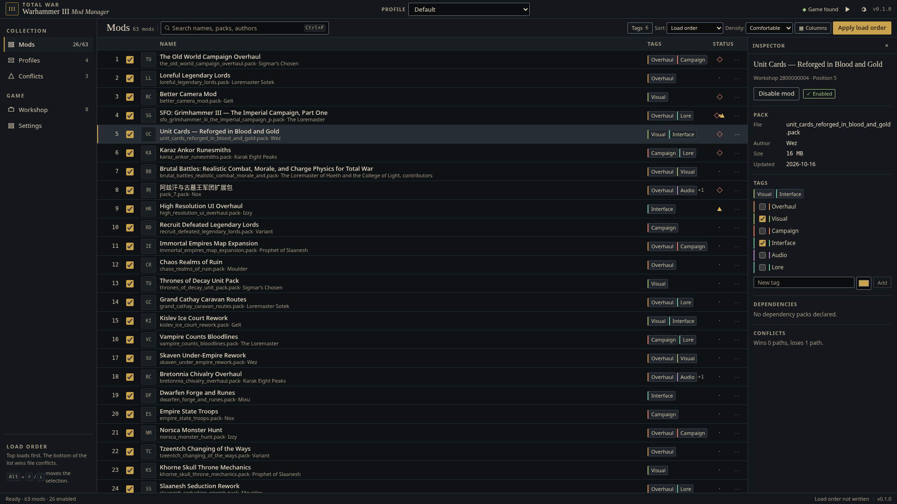

# WH3 Mod Manager

A mod manager for **Total War: Warhammer III**, built with Rust, Tauri 2,
React, and TypeScript. Browse installed mods, arrange load orders, switch
profiles, inspect conflicts, and launch the game with your selected mods.

[Downloads](https://github.com/mak8427/Warhammer_mod_manager/releases) ·
[Installation](#downloads--installation) · [Features](#features) ·
[Build from source](#build-from-source) · [Troubleshooting](docs/TROUBLESHOOTING.md)



## Downloads & installation

[GitHub Releases](https://github.com/mak8427/Warhammer_mod_manager/releases)
is the download location. Draft releases are visible only to maintainers. If
there is no public release yet, use [the source build](#build-from-source).
The table describes the formats built by the release workflows; it does not
mean an unpublished release or an update repository is already available.

| Platform | Installation formats | Architecture |
|---|---|---|
| Windows 10/11 | Per-user `.exe` installer | x86_64 |
| Linux | Flatpak, `.deb`, `.rpm`, AppImage, Arch package, portable tarball | x86_64 |
| Linux with Nix or Gentoo | Hash-pinned Nix flake archive or Gentoo binary overlay archive | x86_64 / amd64 |

macOS and ARM packages are not supported. Linux game launching requires native
Steam, Proton, an existing game prefix, and the Steam Linux Runtime. Start the
game through Steam with Proton once before using the manager. **Installing the
manager as a Flatpak does not add support for Flatpak or Snap Steam.**

### Linux: Flatpak

Download `wh3mm-linux-x86_64.flatpak` from a public release. Install the Flathub
runtime remote if it is not configured, then install and run the bundle:

```bash
flatpak remote-add --user --if-not-exists flathub https://flathub.org/repo/flathub.flatpakrepo
flatpak install --user ./wh3mm-linux-x86_64.flatpak
flatpak run com.warhammerlabs.wh3mm
```

This bundles the app against the GNOME runtime; no Rust, Node, or system
WebKitGTK installation is needed. The manager needs read/write access to Steam
libraries and permission to start host processes for Steam/Proton. These are
broad permissions: this package is not a strong isolation boundary for game files.
See [Flatpak permissions and updates](docs/INSTALLATION.md#flatpak).

An offline bundle alone does not configure automatic app updates. The signed
Flatpak update remote is enabled through the repository publication process below.
This project is not listed on Flathub.

### Linux: Debian / Ubuntu

Download the `.deb`, then install it with apt so runtime dependencies are resolved:

```bash
sudo apt install ./wh3mm_1.0.0_amd64.deb
wh3mm
```

Examples use `1.0.0`; use the version and filename you downloaded. Native
binaries are built on Ubuntu 24.04 and require glibc 2.39 or newer plus WebKitGTK
4.1. Older distributions should use Flatpak.

### Linux: Fedora / openSUSE

Download `wh3mm-<version>-1.x86_64.rpm`, then:

```bash
# Fedora
sudo dnf install ./wh3mm-1.0.0-1.x86_64.rpm

# openSUSE Tumbleweed
sudo zypper install ./wh3mm-1.0.0-1.x86_64.rpm

wh3mm
```

The release RPM declares shared-library dependencies for both distributions.
Direct release RPMs have a SHA-256 checksum; repository-distributed RPMs also
receive a GPG signature. See [verification](docs/INSTALLATION.md#verify-downloads)
if your package manager requires a signature for a direct download.

### Linux: Arch / pacman

Download the prebuilt Arch package and install it with pacman:

```bash
sudo pacman -U ./wh3mm-bin-1.0.0-1-x86_64.pkg.tar.zst
wh3mm
```

Releases also include `PKGBUILD` and `.SRCINFO` for `makepkg -si`. No AUR listing
is assumed. `pacman -S wh3mm-bin` requires the signed update repository to be
configured first.

### Linux: signed update repositories

The repository publisher builds signed **apt, dnf, zypper, pacman, and Flatpak**
repositories after a release is published. **Public hosting and a persistent
signing key must be activated by the maintainer before these commands are usable.**
Until activation, use the downloadable packages above. The setup and activation
instructions are in [the installation guide](docs/INSTALLATION.md#signed-update-repositories).

After configuring the published repository:

```bash
sudo apt update && sudo apt install wh3-mod-manager  # Debian / Ubuntu
sudo dnf install wh3-mod-manager                    # Fedora
sudo zypper refresh && sudo zypper install wh3-mod-manager  # openSUSE
sudo pacman -Syu wh3mm-bin                           # Arch
flatpak update                                     # Flatpak remote installs
```

Normal system updates then update the manager. The repository setup script
verifies the pinned GPG fingerprint before changing package-manager configuration.

### Linux: Nix

Download `wh3mm-nix-<version>.tar.gz` from the same release. This contains a
flake and binary derivation pinned to that release tarball's SHA-256:

```bash
tar -xzf wh3mm-nix-1.0.0.tar.gz
nix run ./wh3mm-nix-1.0.0
nix profile install ./wh3mm-nix-1.0.0
```

Enable Nix's `nix-command` and `flakes` features. Updates use a new release recipe;
there is no in-app updater. NixOS game launching additionally needs an FHS
Steam environment; see [Nix details](docs/INSTALLATION.md#nix).

### Linux: Gentoo

Download `wh3mm-gentoo-<version>.tar.gz`, extract the included local overlay, and
register it with Portage. Then:

```bash
sudo emerge --ask games-util/wh3mm-bin
```

The recipe installs the release binary and provides a checksum Manifest. It needs
amd64, glibc 2.39+, and the declared GTK/WebKit dependencies. Follow the complete
[overlay setup instructions](docs/INSTALLATION.md#gentoo) before running emerge.

### Linux: AppImage / portable tarball

```bash
chmod +x wh3mm_1.0.0_amd64.AppImage
./wh3mm_1.0.0_amd64.AppImage

# Or extract the portable archive:
tar -xzf wh3mm-1.0.0-linux-x86_64.tar.gz
./wh3mm-1.0.0-linux-x86_64/wh3mm
```

These formats need host WebKitGTK 4.1 and GTK3 libraries. AppImage also needs
FUSE 2, or `APPIMAGE_EXTRACT_AND_RUN=1`. See
[runtime dependency commands](docs/INSTALLATION.md#appimage-and-tarball).
Updates require downloading a new release.

### Windows

Download and run the `*-setup.exe` installer from Releases. It installs for the
current user and can download WebView2 if needed. The installer is unsigned;
verify its checksum before running it. Steam must be running for game launching
and Workshop content. The manager starts `Warhammer3.exe` directly to protect
the applied `used_mods.txt` from the Creative Assembly launcher.

### Verify downloads

Download `SHA256SUMS.txt` beside your chosen assets, then:

```bash
sha256sum --ignore-missing -c SHA256SUMS.txt
```

Every downloaded asset checked must show `OK`. On Windows use `Get-FileHash`
and compare with the matching entry. See [verification and removal](docs/INSTALLATION.md).

## Features

- Scan game and Workshop mods; filter, tag, enable, and arrange load order.
- Save profiles and switch between mod configurations.
- Inspect pack conflicts and missing or disabled dependencies.
- Write load orders atomically with backup and recovery.
- Open Workshop pages through Steam; subscription changes stay in the Steam client.
- Launch directly on Windows and through Proton on Linux, with load-order protection.
- Choose compact, comfortable, or roomy list density.

The current feature status and accepted limitations are recorded in
[STATUS](docs/STATUS.md), [product scope](docs/PRODUCT_SCOPE.md), and the
[capability parity scorecard](docs/PARITY.md).

## Architecture

```text
crates/wh3mm-core/   Domain logic, Steam discovery, packs, profiles, launch
crates/wh3mm-app/    Tauri 2 shell and typed command layer
frontend/           React + TypeScript + Vite interface
packaging/          Linux installers, Flatpak, recipes, signed repositories
docs/               Architecture decisions, QA, release and developer guides
```

The frontend accesses files through typed Tauri commands. The core remains
independent of the UI and can be tested without a desktop. The legacy
[WH3 Mod Manager](https://github.com/Shazbot/WH3-Mod-Manager) is a capability
reference; this repository uses a Rust backend and Tauri shell.

## Build from source

### Prerequisites

#### Rust (all platforms)

Install Rust **stable** with [rustup](https://rustup.rs/). `rust-toolchain.toml`
selects the stable channel and the `rustfmt` and `clippy` components, and
`Cargo.toml` requires Rust 1.90 or newer. Rustup installs the pinned components
the first time `cargo` runs in this repository.

#### Node.js and pnpm (all platforms)

- Node.js **24.x** (the repository requires `>=24.15.0`; CI uses Node 24).
- pnpm **12.14.0**, pinned in `package.json` as `packageManager`.

With Node 24, activate the pinned pnpm through Corepack:

```bash
corepack enable
corepack prepare pnpm@12.14.0 --activate
```

If Corepack is not bundled with your Node distribution, install the same
version globally with `npm install -g pnpm@12.14.0`.

#### Windows (desktop shell)

- Windows 10 or 11.
- Microsoft C++ Build Tools with the **Desktop development with C++** workload
  (MSVC compiler, Windows SDK) and the Rust MSVC toolchain
  (`rustup default stable-msvc`).
- WebView2 Runtime. It ships with Windows 11 and current Windows 10; otherwise
  install the Evergreen runtime from Microsoft.

#### Linux (desktop shell)

The Tauri shell builds and runs on Linux against native Steam and Proton
installs. On Linux the game is started through Proton directly, using the
configured compatibility tool, the game's existing `compatdata` prefix, and the
Steam Linux Runtime. There is no automatic Steam fallback on Linux: a missing
prerequisite or a failed spawn is reported as a typed error code. Flatpak and
Snap Steam launches are not covered by this build.

- A C linker and `pkg-config` (`build-essential pkg-config` on Debian/Ubuntu).
- WebKitGTK 4.1 and GTK3 development/runtime packages. On Debian/Ubuntu:

  ```bash
  sudo apt install libwebkit2gtk-4.1-dev libgtk-3-dev \
    libayatana-appindicator3-dev librsvg2-dev libssl-dev libdbus-1-dev
  ```

  On Arch-based distributions:

  ```bash
  sudo pacman -S --needed base-devel webkit2gtk-4.1 \
    libayatana-appindicator librsvg openssl dbus
  ```

- A running X11 or Wayland desktop session.

## Rust backend

Run Rust commands from the repository root. `Cargo.toml` is the workspace root
for `wh3mm-core` (domain logic) and `wh3mm-app` (Tauri command layer plus the
`wh3mm` binary). `--locked` matches CI and keeps `Cargo.lock` authoritative.

The desktop shell embeds `frontend/dist` at compile time. On a clean checkout,
build the frontend before any workspace-wide `cargo` command:

```bash
pnpm install --frozen-lockfile
pnpm build
```

`cargo test -p wh3mm-core --locked` stays WebView- and frontend-free.

```bash
# Fetch dependencies without changing Cargo.lock
cargo fetch --locked

# Build every workspace member
cargo build --workspace --locked

# Run the core, IPC contract, fixture-contract, and command tests
cargo test --workspace --locked

# Verify the committed synthetic fixtures against their manifest
node scripts/qa/generate-fixtures.mjs --verify

# QA script tests (fixture guard + performance-gate validator)
node --test scripts/qa/*.test.mjs

# The same lint gates CI enforces
cargo fmt --all --check
cargo clippy --workspace --all-targets --locked -- -D warnings
```

On Linux, the workspace build compiles the Tauri shell and links WebKitGTK.

## TypeScript frontend

The frontend is the `@wh3mm/desktop` package in `frontend/`, registered in the
pnpm workspace by `pnpm-workspace.yaml`. Run commands from the repository root;
the root scripts forward to the frontend package. `pnpm --dir frontend <script>`
runs the same scripts inside the package.

```bash
# Install all workspace dependencies from the lockfile
pnpm install --frozen-lockfile

# Vite dev server (UI only; Tauri IPC is unavailable in a browser)
pnpm dev            # http://localhost:1420

# Type checking, linting, tests
pnpm typecheck
pnpm lint
pnpm test

# Production build -> frontend/dist
pnpm build

# Release-time performance gate (needs docs/perf/comparison.json; see docs/QA_PLAN.md §7)
node scripts/qa/verify-perf-gate.mjs
```

`pnpm build` runs `tsc --noEmit && vite build`; it does not compile Rust.

## Run the app end to end

There is no separate backend process: the Tauri window and the Rust command
layer start together. From a clean checkout:

```bash
git clone https://github.com/mak8427/Warhammer_mod_manager.git
cd Warhammer_mod_manager
corepack enable
corepack prepare pnpm@12.14.0 --activate
pnpm install --frozen-lockfile
pnpm build
cargo run -p wh3mm-app --locked
```

Order matters: `generate_context!` embeds `frontend/dist` when the Rust shell
compiles, so build the frontend before `cargo run`. The `beforeDevCommand` and
`devUrl` entries in `crates/wh3mm-app/tauri.conf.json` belong to the Tauri CLI,
which this repository does not install; the sequence above is the supported
path. The app enables Tauri's `custom-protocol` feature so cargo-built binaries
serve the embedded frontend instead of the Vite dev server.

On Linux, `cargo build -p wh3mm-app --release --locked` produces
`target/release/wh3mm`. The binary embeds the frontend and requires the
WebKitGTK 4.1 runtime. Release workflows package it as described above;
see [the release guide](docs/RELEASE.md) to reproduce those packages.

Use `cargo test -p wh3mm-core --locked` and `pnpm dev` for headless work.

## Troubleshooting

- **An error code needs an explanation** — see
  [docs/TROUBLESHOOTING.md](docs/TROUBLESHOOTING.md) for every `AppError` code,
  including the Linux Proton launch failures.
- **The build cannot find `frontend/dist`** — run `pnpm build` from the
  repository root before any workspace-wide `cargo` command. Tauri embeds that
  directory at compile time.
- **Linux build cannot find `webkit2gtk-4.1`** — install the Linux desktop
  packages listed above. `pkg-config --modversion webkit2gtk-4.1` must succeed.
- **`wh3mm` exits with a shared-library error on Linux** — the WebKitGTK 4.1
  runtime is missing. Install the runtime packages for your distribution.
- **Steam actions fail on Linux** — this build supports a native Steam client
  (`steam.sh`/`steam`); Flatpak and Snap Steam clients are not covered.

## CI

CI runs all Linux gates plus a Linux Tauri shell build and binary artifact on
every push and pull request. The standalone Windows Tauri check is manual (`workflow_dispatch`); the
release workflow also builds the Windows installer. See
`.github/workflows/ci.yml`.
