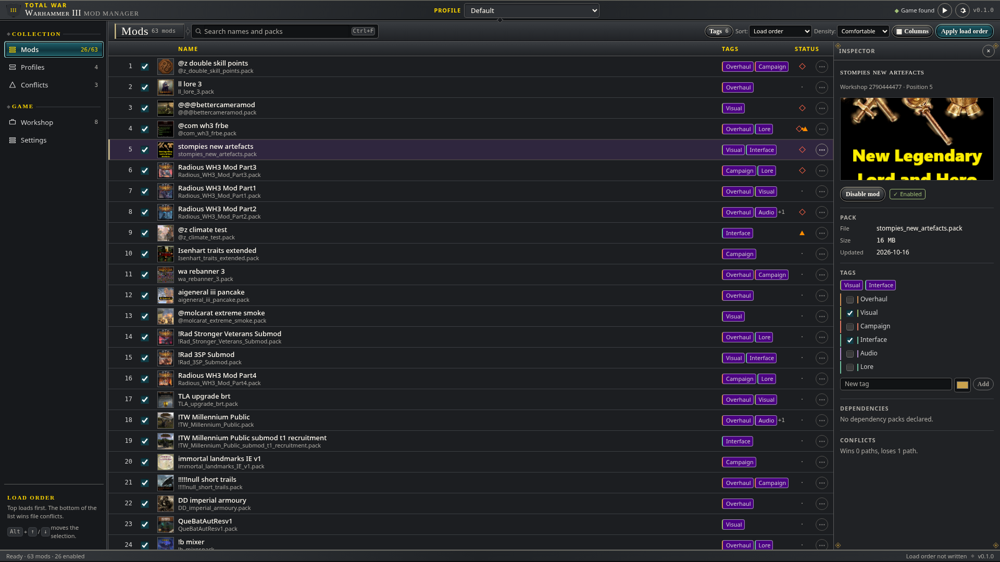
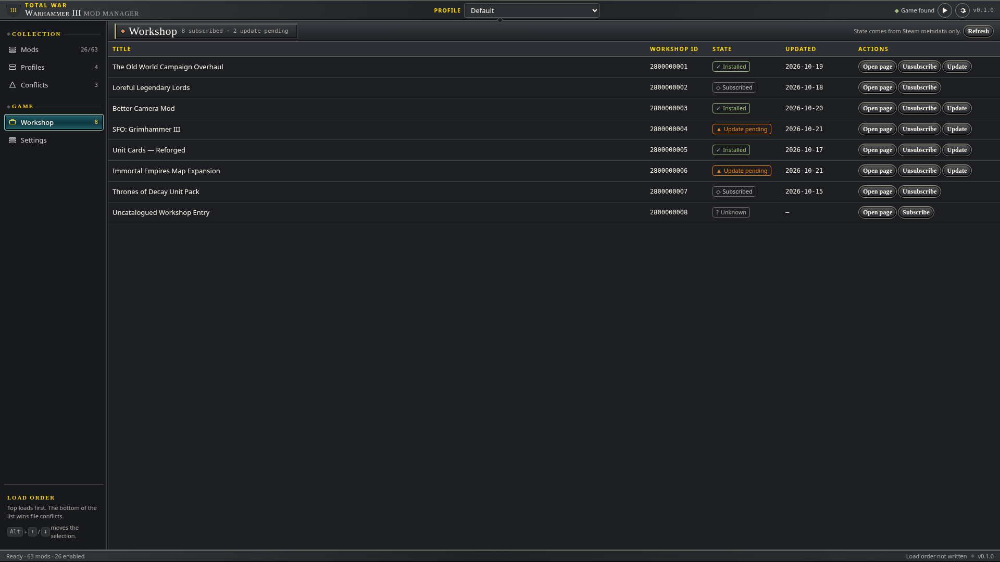
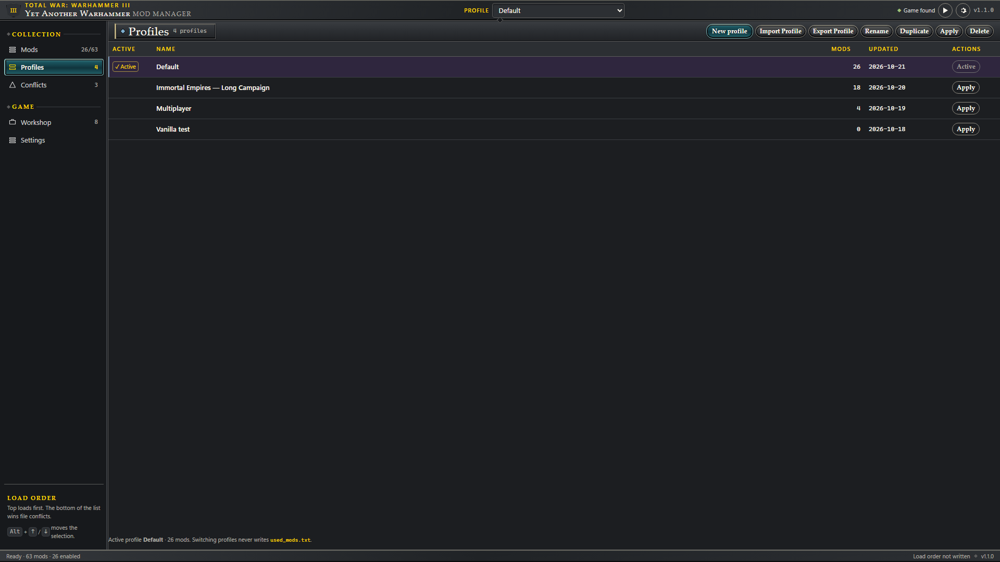
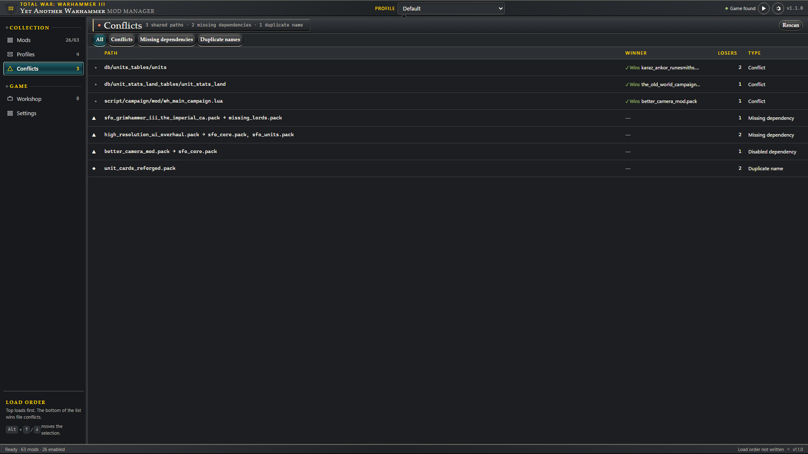
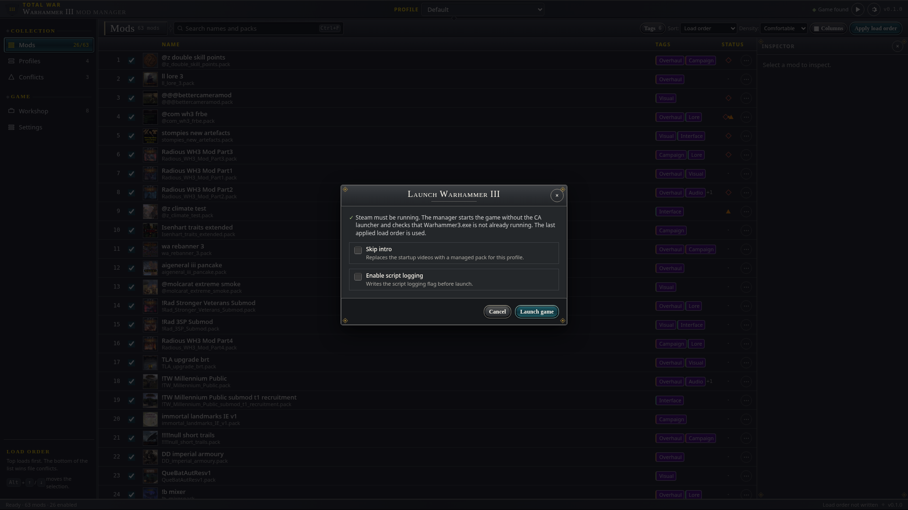
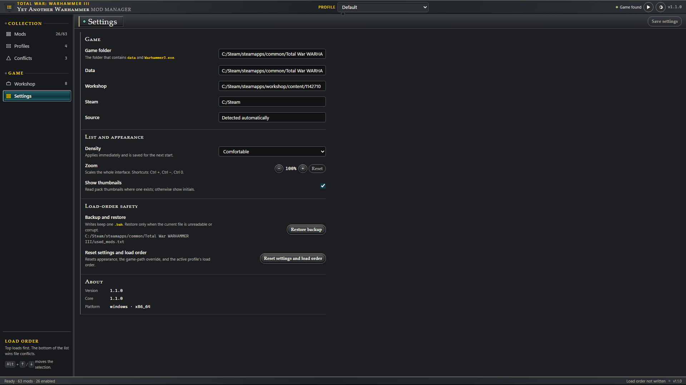

<div align="center">

# WH3 Mod Manager

**Your mod collection. Your load order. Your campaign.**

A mod manager for **Total War: Warhammer III**, built with a Rust core and a Tauri desktop interface.

[](Cargo.toml)
[](crates/wh3mm-app)
[](frontend)
[](#downloads--installation)
[](https://github.com/mak8427/Warhammer_mod_manager/actions/workflows/ci.yml)

[📦 Downloads](#downloads--installation) · [✨ Highlights](#highlights) · [🖼 Showcase](#showcase) · [🛠 Quick Start](#quick-start) · [📋 Features](#feature-matrix) · [🏗 Architecture](#architecture)

</div>



## Downloads & Installation

Get packages from [**GitHub Releases**](https://github.com/mak8427/Warhammer_mod_manager/releases).
Draft releases are private; if no public release is available, use the
[source build](#quick-start). The formats below are produced by the release
workflows. Signed update repositories require the maintainer activation described below.

| Platform | Format | Architecture | Details |
|---|---|---|---|
| Windows 10 / 11 | `-setup.exe` | x86_64 | Per-user installer; WebView2 setup when needed |
| Linux | Flatpak | x86_64 | GNOME runtime; standalone bundle or activated update remote |
| Debian / Ubuntu | `.deb` | amd64 | apt resolves runtime dependencies |
| Fedora / openSUSE Tumbleweed | `.rpm` | x86_64 | Native package with shared-library dependencies |
| Arch Linux | `.pkg.tar.zst`, `PKGBUILD` | x86_64 | Prebuilt pacman package or `makepkg` recipe |
| Linux with Nix / Gentoo | Nix flake / binary overlay archives | x86_64 / amd64 | Recipes pinned to the release tarball's checksums |
| Linux portable | `.AppImage`, `.tar.gz` | x86_64 | Requires host GTK3 / WebKitGTK 4.1 |

> **Game requirements:** Own and install Total War: Warhammer III through Steam.
> On Linux, use **native Steam + Proton**, and launch the game through Steam once
> to create its prefix. The manager's Flatpak package does not add support for
> Flatpak or Snap Steam. macOS and ARM packages are not supported.

<details>
<summary><strong>🐧 Linux — Flatpak, apt, dnf, zypper, pacman, Nix, Gentoo, AppImage</strong></summary>

### Flatpak

Download `wh3mm-linux-x86_64.flatpak` from Releases, then:

```bash
flatpak remote-add --user --if-not-exists flathub https://flathub.org/repo/flathub.flatpakrepo
flatpak install --user ./wh3mm-linux-x86_64.flatpak
flatpak run com.warhammerlabs.wh3mm
```

No system WebKitGTK, Rust, or Node installation is needed. The manager needs
broad filesystem access to edit Steam library files and host-process permission
to launch Steam/Proton. See [Flatpak permissions](docs/INSTALLATION.md#flatpak).

The standalone bundle does not configure automatic app updates. Once the signed
update repository is activated, its `.flatpakref` configures a remote for
`flatpak update` and desktop software stores. This project is not on Flathub;
Flathub supplies the GNOME runtime.

### Debian / Ubuntu

Download the `.deb` and install it with apt:

```bash
sudo apt install ./wh3mm_1.0.0_amd64.deb
wh3mm
```

Commands use `1.0.0` as an example; substitute your downloaded version. Native
release binaries require glibc 2.39+ and WebKitGTK 4.1. They are built on Ubuntu
24.04; for older distributions use Flatpak.

### Fedora / openSUSE Tumbleweed

Download the `.rpm`, then use your distribution's package manager:

```bash
# Fedora
sudo dnf install ./wh3mm-1.0.0-1.x86_64.rpm

# openSUSE Tumbleweed
sudo zypper install ./wh3mm-1.0.0-1.x86_64.rpm

wh3mm
```

Direct release RPMs have SHA-256 checksums. RPMs distributed through the activated
update repository also receive GPG signatures. If your distro requires signatures
for local packages, use the signed repository or another format; see
[download verification](docs/INSTALLATION.md#verify-downloads).

### Arch Linux

Install the prebuilt package:

```bash
sudo pacman -U ./wh3mm-bin-1.0.0-1-x86_64.pkg.tar.zst
wh3mm
```

The release also includes `PKGBUILD` and `.SRCINFO` for `makepkg -si`.
No AUR listing is assumed. `pacman -S wh3mm-bin` needs the update repository below.

### Signed repositories & automatic updates

The publisher supports **apt, dnf, zypper, pacman, and Flatpak**. **Public hosting
and a persistent signing key still need maintainer activation.** Until then,
use the release files above. Follow the
[repository setup guide](docs/INSTALLATION.md#signed-update-repositories) to
configure an activated repository and verify its signing-key fingerprint.

After repository setup, install/update with:

```bash
sudo apt update && sudo apt install wh3-mod-manager        # Debian / Ubuntu
sudo dnf install wh3-mod-manager                          # Fedora
sudo zypper refresh && sudo zypper install wh3-mod-manager # openSUSE
sudo pacman -Syu wh3mm-bin                                 # Arch
flatpak update                                           # Flatpak remote installs
```

Normal package-manager updates then keep the app current. The generated setup
script verifies its pinned GPG fingerprint before changing system configuration.

### Nix

Download the release's `wh3mm-nix-<version>.tar.gz`. It contains a flake and a
binary derivation with the release tarball's URL and SHA-256:

```bash
tar -xzf wh3mm-nix-1.0.0.tar.gz
nix run ./wh3mm-nix-1.0.0
nix profile install ./wh3mm-nix-1.0.0
```

Enable Nix's `nix-command` and `flakes` features. Updates use a new release
recipe. NixOS game launching also needs a Steam FHS environment; see
[Nix setup](docs/INSTALLATION.md#nix).

### Gentoo

Download `wh3mm-gentoo-<version>.tar.gz` and follow the
[local overlay setup](docs/INSTALLATION.md#gentoo), then:

```bash
sudo emerge --ask games-util/wh3mm-bin
```

The binary ebuild provides a Portage checksum Manifest and declares its GTK /
WebKit dependencies. It targets amd64 with glibc 2.39+. No external overlay or
Gentoo-tree listing is assumed.

### AppImage / portable archive

```bash
chmod +x wh3mm_1.0.0_amd64.AppImage
./wh3mm_1.0.0_amd64.AppImage

# Or use the portable archive:
tar -xzf wh3mm-1.0.0-linux-x86_64.tar.gz
./wh3mm-1.0.0-linux-x86_64/wh3mm
```

Both need host WebKitGTK 4.1 / GTK3. AppImage also needs FUSE 2, or run it with
`APPIMAGE_EXTRACT_AND_RUN=1`. See [runtime packages](docs/INSTALLATION.md#appimage-and-tarball).
Update by downloading a new release.

</details>

<details>
<summary><strong>🪟 Windows — per-user installer</strong></summary>

Download and run the `*-setup.exe` from Releases. It installs for the current
user and can download WebView2 if the runtime is missing. The installer is
unsigned; verify its checksum before running it.

Keep Steam running for game launching and Workshop content. The manager starts
`Warhammer3.exe` directly so the Creative Assembly launcher cannot replace the
applied `used_mods.txt`.

</details>

<details>
<summary><strong>🔎 Verify downloads & remove the app</strong></summary>

Download `SHA256SUMS.txt` from the same release beside your selected files:

```bash
sha256sum --ignore-missing -c SHA256SUMS.txt
```

Check that each file you downloaded is listed and reports `OK`. In PowerShell,
use `Get-FileHash .\<downloaded-file> -Algorithm SHA256` and compare it with that
file's entry. Checksums detect corruption; signed repositories also verify the
publisher through their configured GPG key.

For uninstall commands and configuration cleanup, see [the installation guide](docs/INSTALLATION.md).

</details>

## Highlights

- **📚 One view for game and Workshop mods.** Scan installed packs, search and
  filter the list, add tags, and inspect the selected pack.
- **↕️ Control your load order.** Enable mods individually or in batches, drag
  to reorder, and move selections to the top, bottom, or adjacent positions.
- **🗂 Profiles for different campaigns.** Save, duplicate, rename, and switch
  mod configurations without rebuilding the order by hand.
- **🔍 Inspect conflicts before launch.** See overlapping pack content,
  duplicate names, and missing or disabled dependencies.
- **💾 Backups and explicit recovery.** Atomic load-order writes keep a backup;
  corrupt or unmanaged files require an explicit recovery or confirmation step.
- **🎮 Launch with the applied order.** Direct Windows and Linux Proton launch
  paths bypass the CA launcher and check for load-order replacement.
- **🖥 A desktop interface for large lists.** Virtualized rows, keyboard controls,
  and compact, comfortable, or roomy density keep the mod list usable.

## Showcase

| Mod thumbnails & inspector | Workshop subscriptions |
|---|---|
|  |  |
| **Campaign profiles** | **Pack conflicts & dependencies** |
|  |  |
| **Launch options** | **Preferences & density** |
|  |  |

Screenshots use sample profiles and states. Mod-list captures include installed
Workshop mod thumbnails to show how artwork appears in the app. See the
[screenshot record](docs/screenshots/showcase/README.md) for capture details.

## Quick Start

### Prerequisites

- **Rust stable, 1.90+**, with `rustfmt` and `clippy` (`rust-toolchain.toml`).
- **Node.js 24.15+** and **pnpm 12.14.0** (`package.json`).
- **Windows:** MSVC C++ build tools and WebView2.
- **Linux:** a C/C++ toolchain, `pkg-config`, GTK3 / WebKitGTK 4.1 development
  libraries, and an X11 or Wayland desktop session.

Linux dependency commands and full platform setup are in
[the development guide](docs/DEV_SETUP.md).

### Run locally

```bash
git clone https://github.com/mak8427/Warhammer_mod_manager.git
cd Warhammer_mod_manager

# Activate the repository's pnpm version (or install pnpm 12.14.0 directly).
corepack enable
corepack prepare pnpm@12.14.0 --activate

pnpm install --frozen-lockfile
pnpm build
cargo run -p wh3mm-app --locked
```

Build the frontend first: Tauri embeds `frontend/dist` when Rust compiles the
app. There is no separate backend service. `pnpm dev` starts the UI development
server; filesystem and game actions require the Tauri app.

### Workspace commands

| Task | Command |
|---|---|
| Build frontend | `pnpm build` |
| Type check / lint frontend | `pnpm typecheck` / `pnpm lint` |
| Frontend tests | `pnpm test` |
| Rust tests | `cargo test --workspace --locked` |
| Core tests without a desktop/frontend build | `cargo test -p wh3mm-core --locked` |
| Rust format / lint | `cargo fmt --all --check` / `cargo clippy --workspace --all-targets --locked -- -D warnings` |
| QA script tests | `node --test scripts/qa/*.test.mjs` |
| Release recipe tests | `python3 scripts/qa/install-recipes.test.py` |
| Capability check | `node scripts/parity-report.mjs --check` |
| Linux release packages | See [release builds](docs/RELEASE.md#build-locally-on-linux) |

## Feature Matrix

| Capability | Status | Details |
|---|---|---|
| Game & Steam discovery | Implemented; platform caveats | Steam libraries and manual game-folder selection; Flatpak/Snap/XDG discovery is best-effort |
| Mod browsing | Implemented | Local/Workshop packs, search, sort, tags, thumbnails, and selected-pack inspection |
| Load order | Implemented | Enable/disable, batch actions, drag/move controls, atomic writes, and backups |
| Profiles | Implemented | Create, rename, duplicate, delete, switch, and apply saved configurations |
| Conflict inspection | Implemented | Overlapping pack entries, duplicate pack names, and missing/disabled dependencies |
| Workshop | Partial | Read installed/subscribed metadata and open Steam pages; subscribe/unsubscribe/update through Steam |
| Game launch | Implemented; manual QA required | Direct Windows / Proton paths, launch options, running-game checks, and load-order protection |
| Preferences | Implemented; persistence caveats | Density, thumbnails, paths, reset, and backup recovery; see the parity scorecard |
| Large-list UI | Partial | Virtualized rows; persisted scroll and the 20k-row guard remain documented limitations |
| Linux distribution | Implemented in workflows; activation pending | Package/install checks; public releases, signed hosting, and real-game QA are separate gates |

The [capability scorecard](docs/PARITY.md) records evidence and accepted gaps.
[STATUS](docs/STATUS.md) and [product scope](docs/PRODUCT_SCOPE.md) remain the
references for release readiness.

## Architecture

```text
Warhammer_mod_manager/
├── crates/
│   ├── wh3mm-core/   # Steam discovery, packs, profiles, conflicts, load order, launch
│   ├── wh3mm-app/    # Tauri 2 window and typed command layer
│   └── wh3mm-perf/   # Performance measurement harness
├── frontend/        # React + TypeScript + Vite interface
├── packaging/       # Linux packages, Flatpak, Nix/Gentoo recipes, signed updates
├── fixtures/        # Synthetic game, Steam, and pack fixtures
├── scripts/         # Development, QA, and performance tools
└── docs/            # Decisions, evidence, installation, and release guides
```

The frontend accesses files through typed Tauri commands. The Rust core stays
independent of the UI so domain behavior can be tested without a WebView.
Windows uses WebView2; Linux uses WebKitGTK. See
[the architecture decisions](docs/adr/) and [IPC contract](docs/adr/002-ipc-contract.md).

## Documentation & Contributing

| Guide | Contents |
|---|---|
| [Installation](docs/INSTALLATION.md) | Formats, runtime dependencies, updates, verification, and removal |
| [Development setup](docs/DEV_SETUP.md) | Toolchains, local builds, and developer workflow |
| [Troubleshooting](docs/TROUBLESHOOTING.md) | Typed errors, Steam discovery, and launch failures |
| [Release guide](docs/RELEASE.md) | Package builds, signing activation, QA, publication, and rollback |
| [QA plan](docs/QA_PLAN.md) | Acceptance criteria and release checks |
| [Linux QA](docs/MANUAL_QA_LINUX.md) / [Windows QA](docs/MANUAL_QA_WINDOWS.md) | Desktop and game-launch checks |
| [Performance](docs/PERF.md) | Measurement procedure and recorded evidence |
| [Contributing](CONTRIBUTING.md) | Development and review expectations |

The original [WH3 Mod Manager](https://github.com/Shazbot/WH3-Mod-Manager) is the
legacy capability reference. This repository rebuilds the manager with a Rust
backend and a Tauri interface.
